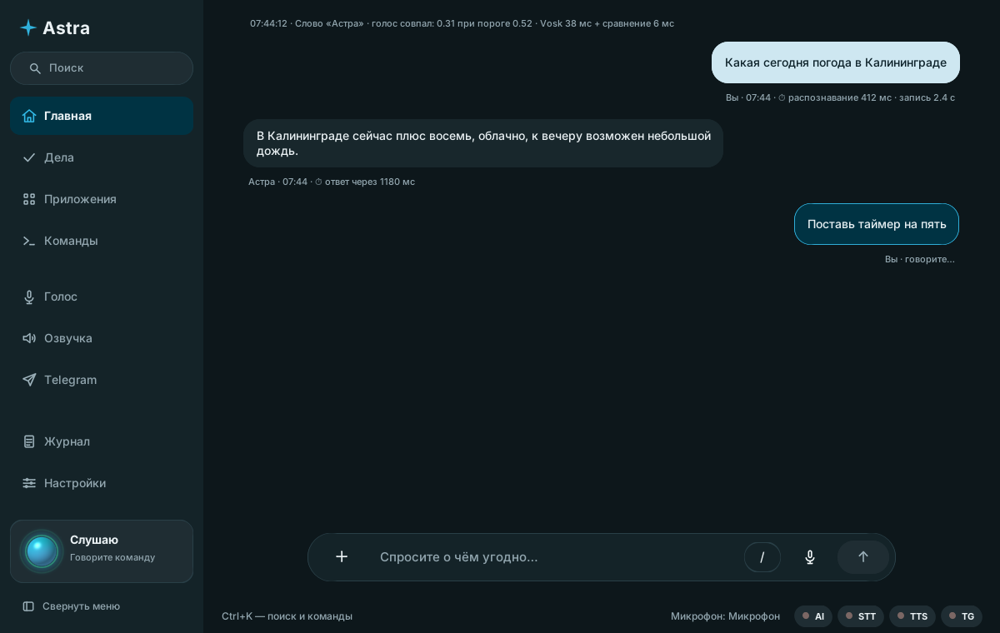
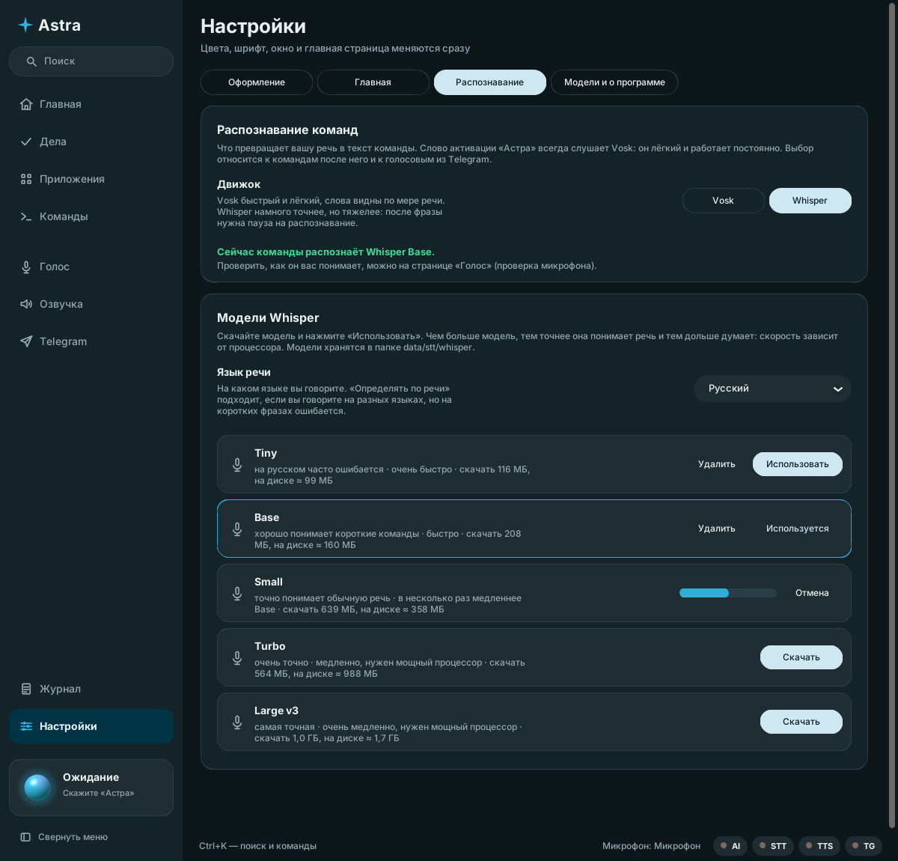
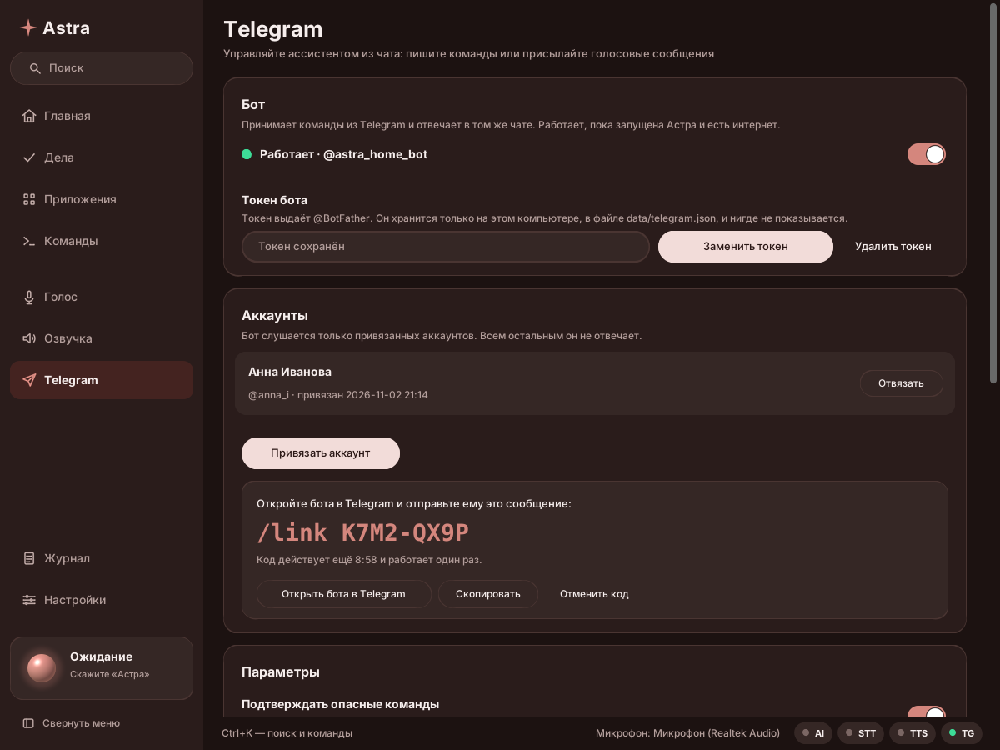
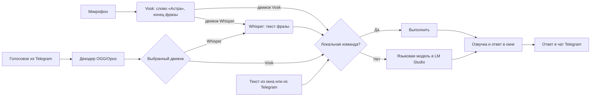

# 👽 Астра — оффлайн-голосовой ассистент

<p align="center">
  <b>Умный голосовой помощник для управления компьютером, работы с мультимедиа и общения с локальной языковой моделью.</b>
</p>

<p align="center">
  
</p>

<p align="center">
  <i>Главный экран: шар показывает, что сейчас делает ассистент; цвета и вид настраиваются под себя</i>
</p>

---

## 📌 Оглавление
- [О проекте](#-о-проекте)
- [Ключевые преимущества](#-ключевые-преимущества)
- [Как это выглядит](#-как-это-выглядит)
- [Быстрый запуск на Windows](#-быстрый-запуск-на-windows)
- [Внешний вид и настройки](#-внешний-вид-и-настройки)
- [Дела и приложения](#-дела-и-приложения)
- [Управление через Telegram](#-управление-через-telegram)
- [Голоса ассистента](#-голоса-ассистента)
- [Распознавание речи](#-распознавание-речи)
- [Настройка ИИ-ответов](#-настройка-ии-ответов)
- [Примеры команд](#-примеры-команд)
- [Требования](#-требования)
- [Установка вручную](#-установка-вручную)
- [Тесты](#-тесты)
- [Структура проекта](#-структура-проекта)
- [Архитектура системы](#-архитектура-системы)
- [Технологии](#-технологии)
- [История изменений](#-история-изменений)

---

## 📖 О проекте

**Астра** — голосовой ассистент для Windows, который позволяет управлять компьютером с помощью голосовых команд, работать с мультимедиа, получать информацию из интернета и взаимодействовать с искусственным интеллектом.

Ассистент сочетает автоматизацию повседневных задач с локальной обработкой речи и возможностью использования языковых моделей.

## ✨ Ключевые преимущества

- 🎙️ **Голосовое управление** — взаимодействие с компьютером с помощью голосовых команд; слова появляются в диалоге, пока вы ещё говорите.
- 🔒 **Конфиденциальность** — локальное распознавание речи и возможность использовать локальную языковую модель.
- 🖥️ **Управление Windows** — выключение и перезагрузка компьютера, горячие клавиши, запуск программ и другие системные команды.
- ⏰ **Дела** — таймеры, будильники, напоминания и список задач голосом или текстом.
- 🎵 **Мультимедиа** — поиск и воспроизведение музыки и фильмов.
- 🌐 **Интернет-функции** — поиск информации, получение погоды и чтение новостей.
- 📱 **Управление из Telegram** — напишите боту или пришлите голосовое сообщение, команда выполнится на компьютере, ответ придёт в чат.
- 🔊 **Голоса** — голоса Windows, нейроголоса без интернета и свои собственные.
- 🎨 **Свой внешний вид** — один цвет окрашивает всё окно, плюс тема, шрифт, масштаб, фон и многое другое.
- 🧩 **Модульная архитектура** — возможность расширять функциональность и добавлять новые команды.

## 📸 Как это выглядит

<table>
  <tr>
    <td width="50%"><br><sub><b>Диалог.</b> Под каждой фразой видно, за сколько миллисекунд она распознана и обработана</sub></td>
    <td width="50%"><br><sub><b>Состояния.</b> Шар «дышит» по-разному, когда ассистент ждёт, слушает, думает и говорит</sub></td>
  </tr>
  <tr>
    <td width="50%"><br><sub><b>Настройки.</b> Всё применяется сразу, без перезапуска</sub></td>
    <td width="50%"><br><sub><b>Быстрый поиск (Ctrl+K).</b> Страницы, цвета и команды в одном списке</sub></td>
  </tr>
  <tr>
    <td width="50%"><br><sub><b>Живой текст речи.</b> Слова появляются в диалоге, пока вы говорите, и заменяются итогом, когда фраза закончена</sub></td>
    <td width="50%"><br><sub><b>Движок распознавания.</b> Vosk или Whisper на выбор, модели Whisper скачиваются прямо из настроек</sub></td>
  </tr>
</table>

<sub>Снимки сделаны при разработке на Linux с запасным шрифтом; в Windows интерфейс использует Segoe UI, поэтому буквы могут выглядеть чуть иначе.</sub>

---

## ⚡ Быстрый запуск на Windows

Скачайте файл [`Astra.bat`](https://raw.githubusercontent.com/Inlerno/Voice_Assistant/main/Astra.bat) (правая кнопка → «Сохранить как…») и запустите двойным щелчком. Он сам скачает проект в папку `Astra` рядом с собой, поставит `uv` и все пакеты и откроет ассистента. Первый запуск занимает несколько минут, следующие — несколько секунд. Если проект уже скачан, `Astra.bat` из его папки просто запускает ассистента.

**Обновление.** Если проект скачан командой `git clone` и в системе есть git, `Astra.bat` сам выполняет `git pull` при каждом запуске. Если он скачан архивом (так делает `Astra.bat`, когда лежит отдельно), автоматического обновления нет: скачайте [свежий архив](https://github.com/Inlerno/Voice_Assistant/archive/refs/heads/main.zip), распакуйте его и скопируйте содержимое папки `Voice_Assistant-main` поверх папки `Astra` с заменой файлов. Свои данные при этом не трогайте: папка `data`, файл `src\config\voice_profile.json` (голос владельца) и большая модель `src\assets\vosk-model-ru-0.42` в архиве отсутствуют, так что заменены не будут. Если вы правили `src\config\commands.json` или `src\config\settings.json`, сохраните свои копии.

---

## 🎨 Внешний вид и настройки

Вкладка «Настройки» → «Оформление». Всё применяется сразу, без перезапуска, и запоминается в `data/ui.json`.

<p align="center">
  
</p>

<p align="center">
  <i>Один и тот же экран в четырёх цветах: достаточно выбрать акцент, остальное подберётся само</i>
</p>

| Что | Варианты |
|---|---|
| **Тема** | Тёмная, светлая или как в Windows |
| **Акцентный цвет** | 10 готовых (бордо, коралл, янтарь, мох, изумруд, океан, синий, фиалка, роза, графит) или любой свой через «+». Все остальные цвета (фон, панели, рамки, текст на кнопках) подбираются под него сами, контраст текста проверяется |
| **Оттенок и глубина фона** | Насколько фон и панели окрашены в цвет акцента; насколько тёмной или светлой делается тема |
| **Шрифт, масштаб, скругление** | Любой шрифт из системы; масштаб 80–150 % (на маленьком экране сам ограничивается, чтобы окно не вылезало за него); углы от прямых до круглых |
| **Меню** | Слева колонкой (можно свернуть до значков) или сверху вкладками |
| **Главная** | Шар-индикатор, логотип или минимализм; приветствие по имени; фон: свечение, однотонный или своя картинка (затемнение и размытие регулируются) |
| **Окно** | Прозрачность, «поверх всех окон», запоминание размера и места |
| **Прочее** | Быстрые кнопки под полем ввода, время ответа у сообщений, анимации |

<table>
  <tr>
    <td width="50%"><br><sub>Светлая тема со своей картинкой на фоне</sub></td>
    <td width="50%"><br><sub>Та же картинка в тёмной теме</sub></td>
  </tr>
</table>

Шар на главной и внизу меню живёт: он по-разному «дышит», пока ассистент ждёт, слушает, думает и говорит, а при паузе микрофона затихает.

**Горячие клавиши** (работают и с русской раскладкой):

| Клавиши | Действие |
|---|---|
| `Ctrl+K` | Быстрый поиск: страницы, действия, настройки оформления и команды ассистента; последняя строка отправляет набранное ассистенту как вопрос |
| `Ctrl+N` | Новый диалог |
| `Ctrl+M` | Включить или выключить микрофон |
| `Ctrl+,` | Настройки |
| `Ctrl+1` … `Ctrl+9` | Страницы по порядку в меню |

Если выбранное оформление почему-то не удалось построить, программа сама возвращается к исходному и пишет причину в журнал. Кнопка «Сбросить оформление» в настройках делает то же вручную.

---

## ⏰ Дела и приложения

Всё это работает голосом (после слова «Астра») и текстом (поле ввода на главной странице или вкладка «Дела»).

| Что сказать | Что произойдёт |
|---|---|
| «Поставь таймер на десять минут», «таймер на полчаса», «таймер на час тридцать чай» | Таймер; по окончании — звук, голос и окно в углу экрана |
| «Разбуди меня в семь тридцать», «будильник на 7:30 по будням», «будильник каждый день в шесть утра» | Будильник (можно с повтором) |
| «Напомни через час позвонить маме», «напомни завтра в девять утра про встречу», «напомни в восемь вечера купить хлеб» | Напоминание |
| «Какие таймеры», «сколько осталось на таймере», «отмени все таймеры» (так же для будильников и напоминаний) | Список и отмена |
| «Добавь задачу купить молоко», «что в списке задач», «выполни задачу два», «удали задачу один», «очисти выполненные задачи» | Список задач |
| «Открой калькулятор», «запусти блокнот», «открой телеграм» | Запуск программы |

<p align="center">
  
</p>

В окне уведомления можно нажать «Готово» или «Ещё 5 мин». Таймеры и напоминания сохраняются в папке `data/` и переживают перезапуск; напоминание, которое пропустили, пока программа была закрыта, сработает при запуске.

Программы берутся из встроенного списка (Блокнот, Калькулятор, Проводник, Paint, Word, Excel и др.), из ярлыков меню «Пуск» (по-английски названные программы понимаются и по-русски: «телеграм», «дискорд») и из вкладки «Приложения» → «Добавить программу».

---

## 📱 Управление через Telegram

Ассистентом можно командовать из чата в Telegram, когда вас нет у компьютера: напишите текст или пришлите **голосовое сообщение**, команда выполнится на компьютере, а ответ придёт в тот же чат. Голосовые распознаёт та же оффлайн-модель Vosk, что слушает микрофон: запись скачивается на ваш компьютер и разбирается там же, отдельный сервис распознавания речи не нужен.

<p align="center">
  
</p>

### Как подключить

1. В Telegram откройте [@BotFather](https://t.me/BotFather), отправьте ему `/newbot`, придумайте имя и логин бота (логин заканчивается на `bot`). В конце BotFather пришлёт **токен**, строку вида `123456789:AAE…`. Токен даёт полный доступ к боту: никому его не показывайте.
2. В Астре откройте страницу «Telegram» (`Ctrl+7`), вставьте токен и нажмите «Сохранить и включить». Астра спросит у Telegram, что это за бот, и запустит его; в строке состояния внизу загорится зелёный индикатор TG.
3. Нажмите «Привязать аккаунт». Появится код вида `/link K7M2-QX9P`. Откройте своего бота в Telegram (кнопка «Открыть бота в Telegram» делает это сама) и отправьте ему это сообщение. Бот ответит «Готово, аккаунт привязан!».
4. Пишите команды или говорите их голосовым сообщением, так же, как ассистенту у компьютера.

Бот работает, пока запущена Астра и компьютер не спит и подключён к интернету. Включить и выключить его можно переключателем на странице «Telegram».

### Что можно сказать

Те же команды, что и в окне: таймеры, будильники, напоминания и задачи, запуск программ, время, погода, новости, поиск, музыка и фильмы, смена голоса. Всё остальное уйдёт языковой модели, ответ придёт в чат.

- Перед ответом бот пишет, что он расслышал в голосовом: `🎙 «поставь таймер на пять минут»`. Так сразу видно, если распознавание ошиблось.
- Если команде нужно уточнение («Для какого города?»), бот задаёт вопрос в чате, а ответом считается следующее ваше сообщение, текстом или голосом. `/cancel` отменяет вопрос.
- Сработавшие таймеры, будильники и напоминания приходят в чат тоже, даже если вы далеко от компьютера (это можно выключить).
- В окне Астры такие сообщения видны в диалоге с пометкой «Telegram · Ваше имя».
- Команды бота: `/help` — подсказка, `/cancel` — отменить вопрос, `/unlink` — отвязать аккаунт.

### Безопасность

Бот управляет компьютером, поэтому доступ к нему закрыт по умолчанию.

- **Только привязанные аккаунты.** Остальным бот отвечает не чаще раза в минуту, что он личный, и ничего не выполняет. В окне Астры видно, что кто-то посторонний ему написал. Групповые чаты бот игнорирует.
- **Привязка по одноразовому коду.** Код показывает только окно Астры, он действует 10 минут и срабатывает один раз. Кто пять раз ошибся с кодом, тому бот 15 минут не верит, даже если он угадает; много неверных попыток от разных аккаунтов уничтожают сам код.
- **Опасные команды ждут кнопки.** «Выключи компьютер», «перезагрузи компьютер», «режим сна» и «очисти корзину» не выполняются, пока вы не нажмёте «Да, выполнить» под вопросом бота (на нажатие даётся минута). Это можно выключить на странице.
- **Команды, которым нужен экран, из чата не работают:** «напиши текст», «закрой программу» (нажимают клавиши в том окне, которое сейчас открыто, а из чата его не видно) и «пока» (завершила бы Астру, после чего чат остался бы без ответа).
- **Старые сообщения не выполняются.** Если компьютер был выключен или без сети, команды старше двух минут пропускаются, а бот сообщает, сколько их было: приказ «выключи компьютер» не должен сработать через час после того, как его отправили.
- **Токен** хранится только в `data/telegram.json` (папка `data` не попадает в git), нигде в окне не показывается и вырезается из журнала и из сообщений об ошибках. Если токен утёк, выпустите новый у @BotFather командой `/revoke`.
- Бот принимает не больше 20 сообщений в минуту от одного человека и держит в очереди не больше 5 команд.

### Параметры

Страница «Telegram» → «Параметры»:

| Параметр | Что делает |
|---|---|
| Подтверждать опасные команды | Включено по умолчанию, см. выше |
| Присылать таймеры и напоминания в чат | Сработавшее дело придёт и в Telegram (включено) |
| Озвучивать ответы на компьютере | Обычно ответ приходит только в чат; включите, чтобы Астра ещё и говорила его вслух (выключено) |
| Прокси, адрес сервера Bot API | Для тех, у кого Telegram не открывается напрямую |

Если Telegram заблокирован, укажите прокси, например `socks5h://127.0.0.1:1080` или `http://127.0.0.1:8080` (буква `h` в `socks5h` заставляет искать адрес Telegram через прокси, а не на вашем компьютере). Запросы, как и у других программ, подчиняются настройкам прокси Windows. Адрес сервера Bot API нужен только тем, кто держит свой сервер.

### Ограничения

- Принимаются текст и голосовые сообщения. Фото, стикеры и видеосообщения-«кружочки» бот не понимает и говорит об этом.
- Голосовое не длиннее двух минут, файл не больше 20 МБ (так ограничивает Telegram).
- Ответы приходят простым текстом, без оформления; знаки Markdown, которые любит ставить языковая модель, бот убирает.
- Команды идут по одной. Пока ассистент занят (например, слушает микрофон), команда из чата ждёт своей очереди, а в чате видно «печатает…».
- Если на вопрос бота не ответить за 90 секунд, он перестаёт ждать ответа, и команда заканчивается без него.

---

## 🔊 Голоса ассистента

Вкладка «Озвучка»: выбор голоса, темп и громкость, кнопка «Слушать» у каждого голоса.

<p align="center">
  
</p>

- **Голоса Windows** (Ирина, Павел и другие, что установлены в системе) работают сразу.
- **Каталог нейроголосов** (Ирина, Денис, Дмитрий, Руслан): звучат естественнее, работают без интернета после одной загрузки (≈67 МБ каждый). Движок — [sherpa-onnx](https://github.com/k2-fsa/sherpa-onnx), модели Piper.
- **Свой голос:** «Добавить свой голос» → выберите файл Piper (`.onnx`; рядом должен лежать `.onnx.json`), готовый архив или папку sherpa-onnx. Русские голоса Piper лежат на [huggingface.co/rhasspy/piper-voices](https://huggingface.co/rhasspy/piper-voices/tree/main/ru/ru_RU). Файлы копируются в `data/voices/`, голос можно удалить кнопкой.
- **Голосом:** «смени голос», «говори голосом Денис», «каким голосом ты говоришь», «говори быстрее / медленнее / тише / громче».
- Если нейроголос по какой-то причине не сработал, фразу произнесёт голос Windows, ассистент не замолчит.

---

## 🎤 Распознавание речи

### Живой текст речи

Пока вы произносите команду, распознанные слова уже видны в диалоге: «Поставь» → «Поставь таймер» → «Поставь таймер
на пять минут». Это бледный пузырь справа с подписью «Вы · говорите…»; когда фраза закончена, на его месте появляется
обычное сообщение с итоговым текстом и временем распознавания. Если ничего связного не расслышано (шум, кашель), пузырь
просто исчезает, а пустой диалог не остаётся.

Включается в «Настройки → Главная → Живой текст речи» (по умолчанию включено). С выключенным переключателем
распознаватель не запрашивает промежуточный текст у модели вовсе, так что слабому компьютеру это ничего не стоит.
Работает при любой модели Vosk; слово активации «Астра» и голосовые из Telegram показываются, как раньше, целиком.

### Движок: Vosk или Whisper

Команды после слова «Астра» и голосовые из Telegram распознаёт движок на ваш выбор: **Vosk** (по умолчанию) или
**Whisper**. Переключатель и модели Whisper — в «Настройки → Распознавание». Whisper заметно точнее понимает обычную
речь, но он тяжелее и не умеет работать с потоком, поэтому после фразы ему нужна короткая пауза на распознавание.

Как это устроено. Микрофон по-прежнему слушает Vosk (маленькая модель): он ждёт слово «Астра», находит конец фразы и
показывает слова по ходу речи (см. «Живой текст речи»). Когда фраза закончена, её запись целиком распознаёт Whisper, и
его текст заменяет текст Vosk. Под фразой в чате подписано, чем она распознана: «распознавание (Whisper base) 420 мс ·
запись 2.6 с». Так же работают голосовые из Telegram и проверка микрофона на странице «Голос».

Whisper запускается через `sherpa-onnx` (он и так нужен для нейроголосов), новых пакетов не требуется. Модели
качаются кнопкой «Скачать» с полосой прогресса, отменой и докачкой при обрыве связи:

| Модель | Скачать | На диске | Что даёт |
|--------|--------:|---------:|----------|
| Tiny | 116 МБ | ≈ 99 МБ | очень быстро, на русском часто ошибается |
| Base | 208 МБ | ≈ 160 МБ | быстро, хорошо понимает короткие команды |
| Small | 639 МБ | ≈ 358 МБ | точно понимает обычную речь, в несколько раз медленнее Base |
| Turbo | 564 МБ | ≈ 988 МБ | очень точно, нужен мощный процессор |
| Large v3 | 1,0 ГБ | ≈ 1,7 ГБ | самая точная, очень медленно |

Нажмите «Использовать», и модель загрузится в фоне (до минуты); пока она грузится, команды распознаёт Vosk, а о
готовности Whisper сообщит чат. Модели лежат в `data/stt/whisper`, выбор запоминается в `data/stt.json`. Можно положить
в эту папку и свою модель (`encoder.onnx`, `decoder.onnx`, `tokens.txt` в подпапке): она появится в списке.

- **Язык речи.** По умолчанию русский. «Определять по речи» подойдёт тем, кто говорит на разных языках, но на коротких
  фразах Whisper ошибается в определении языка.
- **Защита от выдумок.** На тишине и шуме Whisper любит «сочинять» текст (чаще всего титры: «Субтитры сделал…»). Такие
  фразы отбрасываются, как и текст из одного слова, повторённого много раз.
- **Числа.** Whisper пишет «1,5 часа» и «5 минут» цифрами; разбор команд понимает и это («поставь таймер на 1,5 часа»).
- **Запасной путь.** Если модель не загрузилась, её удалили или Whisper споткнулся на записи, команду распознаёт Vosk.
- **Память.** Пока выбран Whisper, большая модель Vosk в память не грузится (она нужна лишь как запасная).

На проверенных записях модель Base распознаёт все три тестовые команды («поставь таймер на пять минут», «добавь задачу
купить молоко», «выключи компьютер») за 0,3–0,5 с на фразу; Tiny путает «добавь задачу». Скорость зависит от
процессора, а точность на вашем голосе и микрофоне лучше проверить самому: время распознавания видно в чате.

### Маленькая и большая модель

Вместе с проектом идёт маленькая модель Vosk (`vosk-model-small-ru-0.22`, ~45 МБ). Она запускается мгновенно и
слушает слово «Астра». Команды можно распознавать точнее с большой моделью: по таблице авторов Vosk она
ошибается в 2–4 раза реже, но весит больше гигабайта, дольше загружается и занимает много оперативной памяти.

```
uv run python scripts/download_vosk_model.py
```

Скрипт скачивает `vosk-model-ru-0.42` в `src/assets` (докачивает при обрыве, проверяет место на диске).
Настройки не нужны: после перезапуска ассистент находит модель сам, загружает её в фоне и сообщает об этом
в чате. Пока она грузится, команды распознаёт маленькая. Если большой модели нет или она не загрузилась,
всё продолжает работать на маленькой. В git большая модель не попадает.

Время работы распознавания в миллисекундах видно в чате под каждой вашей фразой, так что разницу можно
сравнить на своём компьютере. Большая модель Vosk нужна, пока команды распознаёт Vosk; с Whisper в качестве движка она
не загружается.

### Проверка микрофона

Вкладка «Голос» → «Проверка микрофона»: ассистент 5 секунд слушает выбранное устройство, показывает уровень
сигнала, говорит, в чём проблема (нет сигнала, слишком тихо, слишком громко) и показывает, что он расслышал.

### Голос владельца

Там же, «Голос владельца»: скажите «Астра» пять раз, и ассистент запомнит, как звучит ваш голос. После этого он
реагирует на слово активации только в вашем исполнении, а профиль сам подстраивается под вас по ходу работы.
Чувствительность настраивается ползунком, профиль можно сбросить. Он хранится только на вашем компьютере
(`src/config/voice_profile.json`) и в git не попадает.

---

## 🧠 Настройка ИИ-ответов

Ассистент использует локальную LLM-модель с кастомизированным system_prompt<br>
**Правила:**
- **Краткие, но информативные** (1-2 предложения)
- **Дружелюбные и естественные**
- **Предложение поиска в интернете, если нужны точные данные (курс валют и т.д.)**
- **Блокировку вредоносных, опасных или неэтичных запросов**
- **Без сложных терминов**
- **Структурированные** для списков/инструкций

## 💬 Примеры команд
```bash
"Астра, открой браузер"
"Астра, какая погода?" → ассистент: "Укажите город" → пользователь называет город → ассистент сообщает погоду"
"Астра, выключи компьютер"
"Астра, поставь таймер на десять минут"
"Астра, добавь задачу купить молоко"
"Астра, говори тише"
```
Список всех команд — на вкладке «Команды», каждую можно запустить кнопкой.

---

## 📋 Требования
- Windows 10/11
- Python 3.13 (отдельно ставить не нужно: его поставит `uv`, см. `.python-version`)
- Микрофон
- Интернет *(при первом запуске для установки пакетов и по желанию для больших моделей, моделей Whisper и голосов; в работе — только для некоторых функций: погода, новости, поиск и онлайн-медиа)*
- Google Chrome *(для онлайн-медиа)*
- Аккаунт Telegram и бот от @BotFather *(только для управления из чата)*

## 📦 Установка вручную
1. Клонируйте репозиторий:
   ```bash
   git clone https://github.com/Inlerno/Voice_Assistant.git
   cd Voice_Assistant
   ```
2. Установите [uv](https://docs.astral.sh/uv/), если его ещё нет (`Astra.bat` делает это сам).
3. Установите зависимости (`uv` сам создаст окружение `.venv` и поставит нужный Python):
   ```bash
   uv sync
   ```
4. Запустите ассистента:
   ```bash
   uv run python run.py
   ```

## 🧪 Тесты
```bash
uv run python -m unittest discover -s tests
```
Тесты покрывают ядро ассистента, проверку микрофона, голос владельца, большую модель, живой текст речи, Whisper, дела (таймеры,
задачи, запуск программ), голоса, палитру и настройки оформления, шар-индикатор, быстрый поиск, обои и окно целиком. Тест окна
открывает его на мгновение. На сервере без экрана (Linux) его запускают через
`xvfb-run -a python -m unittest discover -s tests`, а без экрана он просто пропускается.

Бот Telegram проверяется на маленьком сервере, который имитирует Bot API (`tests/fake_telegram.py`): привязка по коду,
текст и голос, вопросы и кнопки подтверждения, ошибки и обрыв сети, защита токена. Декодирование голосовых проверяется
на настоящих OGG/Opus, а `tests/test_voice_e2e.py` прогоняет записи из `tests/data` через настоящую модель Vosk: что
сказано в записи, то и выполняется. `tests/test_live_speech_e2e.py` подаёт те же записи в распознаватель блок за блоком,
как микрофон, и проверяет, что слова растут по ходу фразы и пропадают после итога. Если модели или `vosk` нет, эти тесты
пропускаются.

Whisper проверяется без настоящей модели (подставной движок: разбор записи, каталог, скачивание с докачкой и отменой,
выбор движка, запасной путь на Vosk, окно настроек) и с настоящей: `tests/test_whisper_e2e.py` прогоняет те же записи
через живой Whisper и проверяет и текст, и то, что с ним делают таймер и задачи. Для него скачайте модель (лучше Base) в
«Настройки → Распознавание» или укажите папку модели в переменной `ASTRA_WHISPER_MODEL`; без модели тест пропускается.

## 📁 Структура проекта
```text
Voice_Assistant/
├── run.py                            # Запуск: uv run python run.py
├── Astra.bat                         # Запуск в один щелчок на Windows
├── CHANGELOG.md                      # История изменений
├── pyproject.toml, uv.lock           # Зависимости
├── .python-version                   # Версия Python
├── docs/screenshots/                 # Снимки интерфейса для README
├── scripts/
│   └── download_vosk_model.py        # Скачивание большой модели распознавания речи
├── src/
│   ├── main.py                       # Точка входа
│   ├── core/
│   │   ├── assistant_core.py         # Ядро: прослушивание, команды, ответы
│   │   ├── remote.py                 # Что ядро даёт чатам: проверка команды перед запуском, текст из чата
│   │   └── risky.py                  # Опасные команды и те, что работают только на самом компьютере
│   ├── speech/                       # Работа с речью
│   │   ├── speech_module.py          # Распознавание речи: слово «Астра», команды, живой текст
│   │   ├── whisper_engine.py         # Whisper (sherpa-onnx): каталог моделей, скачивание, распознавание записи
│   │   ├── stt_control.py            # Выбор движка и модели Whisper, загрузка в фоне
│   │   ├── stt_settings.py           # Движок, модель и язык (data/stt.json)
│   │   ├── spoken.py                 # Фраза «как сказано»: строчные буквы, без знаков препинания
│   │   ├── voice_profile.py          # Голос владельца
│   │   ├── voice_commands.py         # Голосовое управление озвучкой («говори тише»)
│   │   ├── tts_module.py             # Озвучка: голоса Windows и нейроголоса
│   │   └── voices.py                 # Голоса: каталог, свои голоса, настройки
│   ├── audio/
│   │   ├── sound_module.py           # Воспроизведение звуков
│   │   ├── mic_test.py               # Проверка микрофона
│   │   └── audio_decode.py           # Голосовые из чата (OGG/Opus) → звук для Vosk
│   ├── system/
│   │   └── system_control.py         # Управление ОС
│   ├── productivity/                 # Таймеры, будильники, напоминания, задачи, запуск программ
│   │   ├── planner.py, ru_parse.py   # Дела и разбор русских дат и времени
│   │   └── apps.py, skills.py        # Запуск программ и голосовые фразы дел
│   ├── interface/                    # Пользовательский интерфейс (customtkinter)
│   │   ├── interface.py              # Окно: меню, страницы, строка состояния, перестройка по настройкам
│   │   ├── nav.py                    # Боковое и верхнее меню, строка состояния
│   │   ├── home_page.py              # Главная: шар или логотип, приветствие, поле ввода, диалог
│   │   ├── settings_page.py          # Настройки: оформление, главная, распознавание, модели
│   │   ├── stt_section.py            # Вкладка «Распознавание»: Vosk или Whisper, модели, язык
│   │   ├── preferences.py            # Настройки оформления (data/ui.json): проверка и сохранение
│   │   ├── palette.py                # Цвета из одного акцента (OKLCH), проверка контраста
│   │   ├── orb.py                    # Живой шар-индикатор состояния
│   │   ├── wallpaper.py              # Своя картинка на главной: размер, размытие, затемнение
│   │   ├── command_palette.py        # Быстрый поиск (Ctrl+K)
│   │   ├── voice_page.py             # Микрофон, проверка микрофона, голос владельца
│   │   ├── planner_page.py           # Дела: таймеры, будильники, напоминания, задачи
│   │   ├── apps_page.py              # Приложения, которые можно открыть голосом
│   │   ├── tts_page.py               # Озвучка: голоса, каталог, свои голоса
│   │   ├── telegram_page.py          # Telegram: токен, привязка аккаунтов, параметры
│   │   ├── notification.py           # Окно «сработал таймер / будильник»
│   │   ├── pages.py                  # Команды, модель, журнал
│   │   ├── widgets.py, theme.py      # Кнопки, переключатели, подсказки, карточки; цвета и шрифт из настроек
│   │   ├── ctk_fixes.py              # Обход ошибки customtkinter при смене масштаба
│   │   └── graphics.py               # Иконки и фоновое свечение (Pillow)
│   ├── integrations/
│   │   ├── chat_gpt.py               # Языковая модель
│   │   └── telegram/                 # Бот Telegram: приём команд текстом и голосом
│   │       ├── api.py                # Клиент Bot API (requests): ошибки, прокси, защита токена
│   │       ├── bot.py                # Опрос чата, текст и голос, кнопки, вопросы, очередь
│   │       ├── pairing.py            # Одноразовый код привязки аккаунта
│   │       └── settings.py           # Настройки и список аккаунтов (data/telegram.json)
│   ├── network/
│   │   └── network.py                # Сетевые операции
│   ├── services/                     # Сервисы контента
│   │   ├── film_service.py
│   │   ├── music_service.py
│   │   └── web_driver_manager.py
│   ├── config/
│   │   ├── commands.json             # Команды ассистента
│   │   └── settings.json             # Выбранный микрофон и тема (тёмная, светлая, системная)
│   └── assets/
│       ├── img/                      # Баннер и значки
│       ├── sounds/                   # Звуки запуска и выключения
│       ├── main_applications/        # Ярлыки программ
│       └── vosk-model-small-ru-0.22/ # Маленькая модель распознавания речи
├── tests/                            # Тесты (unittest); tests/data: записи голосовых для сквозного теста
├── data/                             # Появляется при работе, в git не попадает: дела, оформление, голоса
└── logs/                             # Появляется при работе, в git не попадает: assistant.log
```

## 🧩 Архитектура системы


## 🔌 Технологии
| Модуль          | Описание                          |
|-----------------|-----------------------------------|
| `vosk`          | Оффлайн распознавание речи: слово «Астра», живой текст, команды |
| `sounddevice`   |Запись аудио с микрофона           |
| `pyttsx3`       | Синтез речи (голоса Windows)      |
| `sherpa-onnx`   | Нейроголоса (Piper), свои голоса, распознавание Whisper |
| `numpy`         | Работа с аудиоданными, шар-индикатор |
| `soundfile`     | Чтение голосовых сообщений Telegram (OGG/Opus) |
| `RapidFuzz`     | Нечеткий поиск команд             |
| `lmstudio`      | Локальные LLM-модели для ответов  |
| `selenium`      | Автоматизация браузера для медиа  |
| `fake-useragent`| Генерация случайных User-Agent для веб-запросов|
| `webdriver-manager`| Управление драйверами для Selenium|
| `feedparser`   | Чтение новостей RSS-лент|
| `BeautifulSoup`| Очистка текста новостей от HTML-тегов|
| `requests`         |HTTP-запросы к API и веб-серверам, Telegram Bot API|
| `PySocks`       | SOCKS-прокси для Telegram         |
| `pygame`        | Воспроизведение аудио             |
| `pywin32`       | Интеграция с Windows API          |
| `keyboard`      | Эмуляция нажатия клавиш           |
| `pyperclip`     | Работа с буфером обмена           |
| `customtkinter` | Современный GUI интерфейс         |
| `pillow`        | Иконки, шар-индикатор и фон интерфейса |

## 📜 История изменений

Что и когда менялось — в файле [CHANGELOG.md](CHANGELOG.md).
