# 🚀 Астра — оффлайн-голосовой ассистент

<p align="center">
  
</p>

<p align="center">
  <b>Умный голосовой помощник для управления компьютером, работы с мультимедиа и общения с локальной языковой моделью.</b>
</p>

<p align="center">
  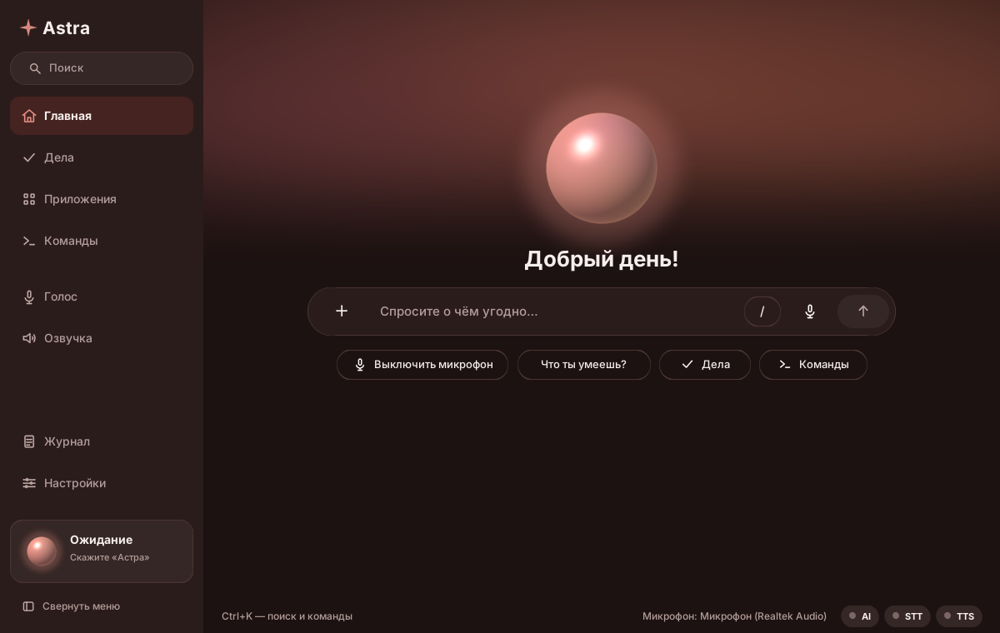
</p>

<p align="center">
  <i>Главный экран: шар показывает, что сейчас делает ассистент; цвета и вид настраиваются под себя</i>
</p>

---

## 📌 Оглавление
- [О проекте](#-о-проекте)
- [Ключевые преимущества](#-ключевые-преимущества)
- [Как это выглядит](#-как-это-выглядит)
- [Быстрый запуск на Windows](#-быстрый-запуск-на-windows)
- [Внешний вид и настройки](#-внешний-вид-и-настройки)
- [Дела и приложения](#-дела-и-приложения)
- [Голоса ассистента](#-голоса-ассистента)
- [Распознавание речи](#-распознавание-речи)
- [Настройка ИИ-ответов](#-настройка-ии-ответов)
- [Примеры команд](#-примеры-команд)
- [Требования](#-требования)
- [Установка вручную](#-установка-вручную)
- [Тесты](#-тесты)
- [Структура проекта](#-структура-проекта)
- [Архитектура системы](#-архитектура-системы)
- [Технологии](#-технологии)
- [История изменений](#-история-изменений)

---

## 📖 О проекте

**Астра** — голосовой ассистент для Windows, который позволяет управлять компьютером с помощью голосовых команд, работать с мультимедиа, получать информацию из интернета и взаимодействовать с искусственным интеллектом.

Ассистент сочетает автоматизацию повседневных задач с локальной обработкой речи и возможностью использования языковых моделей.

## ✨ Ключевые преимущества

- 🎙️ **Голосовое управление** — взаимодействие с компьютером с помощью голосовых команд.
- 🔒 **Конфиденциальность** — локальное распознавание речи и возможность использовать локальную языковую модель.
- 🖥️ **Управление Windows** — выключение и перезагрузка компьютера, горячие клавиши, запуск программ и другие системные команды.
- ⏰ **Дела** — таймеры, будильники, напоминания и список задач голосом или текстом.
- 🎵 **Мультимедиа** — поиск и воспроизведение музыки и фильмов.
- 🌐 **Интернет-функции** — поиск информации, получение погоды и чтение новостей.
- 🔊 **Голоса** — голоса Windows, нейроголоса без интернета и свои собственные.
- 🎨 **Свой внешний вид** — один цвет окрашивает всё окно, плюс тема, шрифт, масштаб, фон и многое другое.
- 🧩 **Модульная архитектура** — возможность расширять функциональность и добавлять новые команды.

## 📸 Как это выглядит

<table>
  <tr>
    <td width="50%">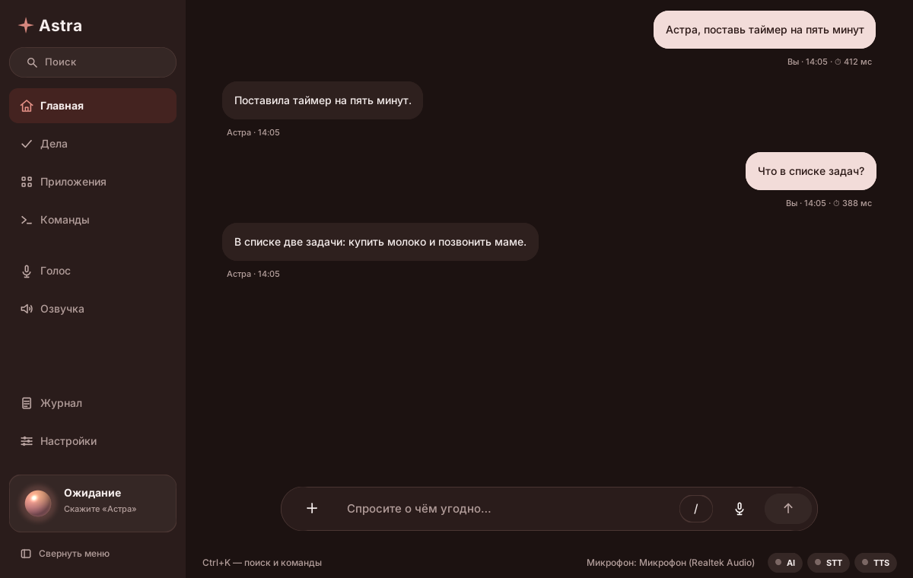<br><sub><b>Диалог.</b> Под каждой фразой видно, за сколько миллисекунд она распознана и обработана</sub></td>
    <td width="50%">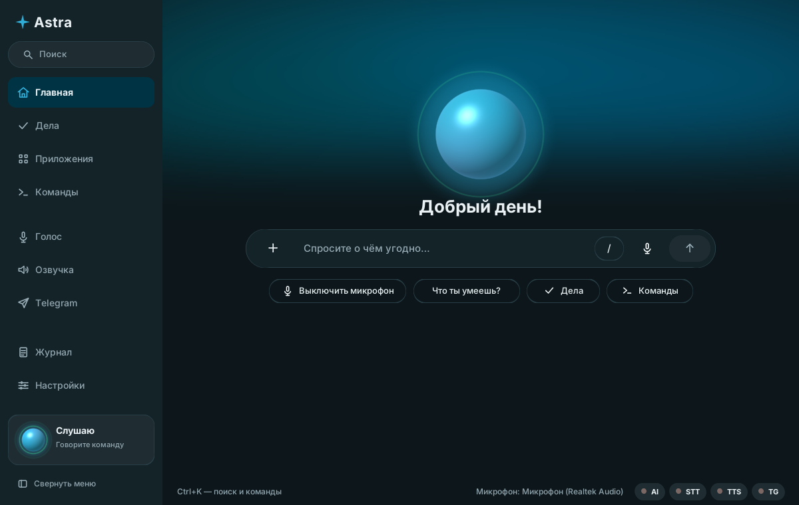<br><sub><b>Состояния.</b> Шар «дышит» по-разному, когда ассистент ждёт, слушает, думает и говорит</sub></td>
  </tr>
  <tr>
    <td width="50%">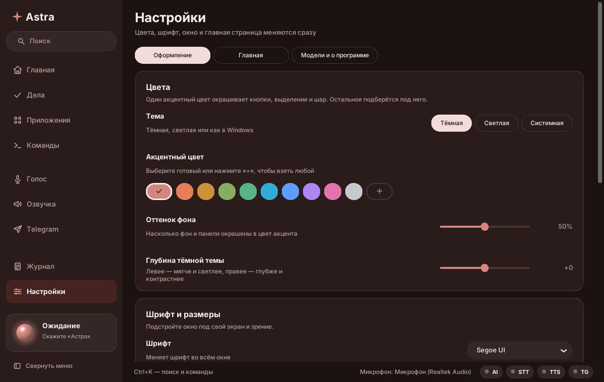<br><sub><b>Настройки.</b> Всё применяется сразу, без перезапуска</sub></td>
    <td width="50%">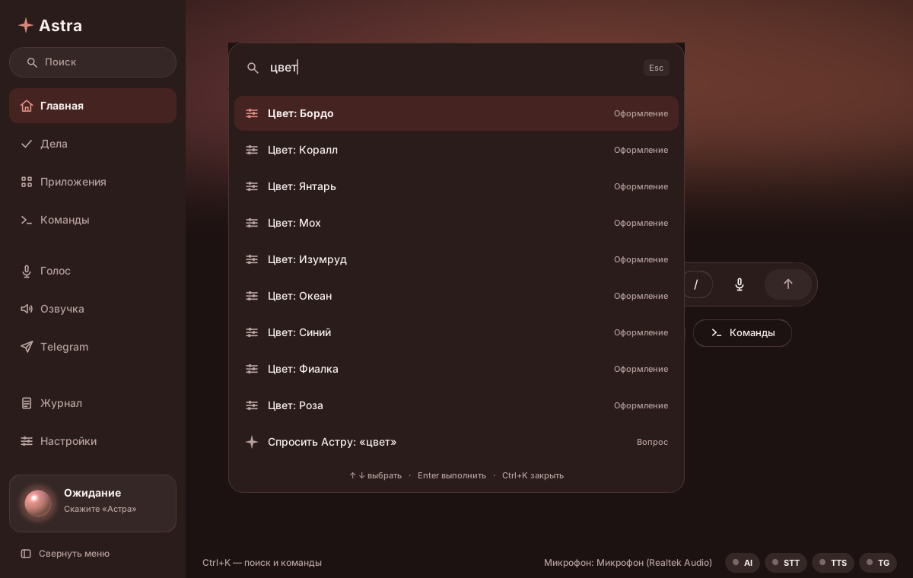<br><sub><b>Быстрый поиск (Ctrl+K).</b> Страницы, цвета и команды в одном списке</sub></td>
  </tr>
</table>

<sub>Снимки сделаны при разработке на Linux с запасным шрифтом; в Windows интерфейс использует Segoe UI, поэтому буквы могут выглядеть чуть иначе.</sub>

---

## ⚡ Быстрый запуск на Windows

Скачайте файл [`Astra.bat`](https://raw.githubusercontent.com/Inlerno/Voice_Assistant/main/Astra.bat) (правая кнопка → «Сохранить как…») и запустите двойным щелчком. Он сам скачает проект в папку `Astra` рядом с собой, поставит `uv` и все пакеты и откроет ассистента. Первый запуск занимает несколько минут, следующие — несколько секунд. Если проект уже скачан, `Astra.bat` из его папки просто запускает ассистента.

**Обновление.** Если проект скачан командой `git clone` и в системе есть git, `Astra.bat` сам выполняет `git pull` при каждом запуске. Если он скачан архивом (так делает `Astra.bat`, когда лежит отдельно), автоматического обновления нет: скачайте [свежий архив](https://github.com/Inlerno/Voice_Assistant/archive/refs/heads/main.zip), распакуйте его и скопируйте содержимое папки `Voice_Assistant-main` поверх папки `Astra` с заменой файлов. Свои данные при этом не трогайте: папка `data`, файл `src\config\voice_profile.json` (голос владельца) и большая модель `src\assets\vosk-model-ru-0.42` в архиве отсутствуют, так что заменены не будут. Если вы правили `src\config\commands.json` или `src\config\settings.json`, сохраните свои копии.

---

## 🎨 Внешний вид и настройки

Вкладка «Настройки» → «Оформление». Всё применяется сразу, без перезапуска, и запоминается в `data/ui.json`.

<p align="center">
  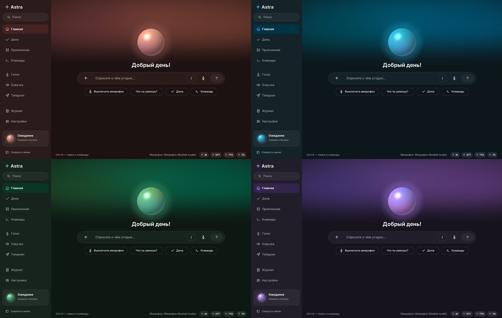
</p>

<p align="center">
  <i>Один и тот же экран в четырёх цветах: достаточно выбрать акцент, остальное подберётся само</i>
</p>

| Что | Варианты |
|---|---|
| **Тема** | Тёмная, светлая или как в Windows |
| **Акцентный цвет** | 10 готовых (бордо, коралл, янтарь, мох, изумруд, океан, синий, фиалка, роза, графит) или любой свой через «+». Все остальные цвета (фон, панели, рамки, текст на кнопках) подбираются под него сами, контраст текста проверяется |
| **Оттенок и глубина фона** | Насколько фон и панели окрашены в цвет акцента; насколько тёмной или светлой делается тема |
| **Шрифт, масштаб, скругление** | Любой шрифт из системы; масштаб 80–150 % (на маленьком экране сам ограничивается, чтобы окно не вылезало за него); углы от прямых до круглых |
| **Меню** | Слева колонкой (можно свернуть до значков) или сверху вкладками |
| **Главная** | Шар-индикатор, логотип или минимализм; приветствие по имени; фон: свечение, однотонный или своя картинка (затемнение и размытие регулируются) |
| **Окно** | Прозрачность, «поверх всех окон», запоминание размера и места |
| **Прочее** | Быстрые кнопки под полем ввода, время ответа у сообщений, анимации |

<table>
  <tr>
    <td width="50%">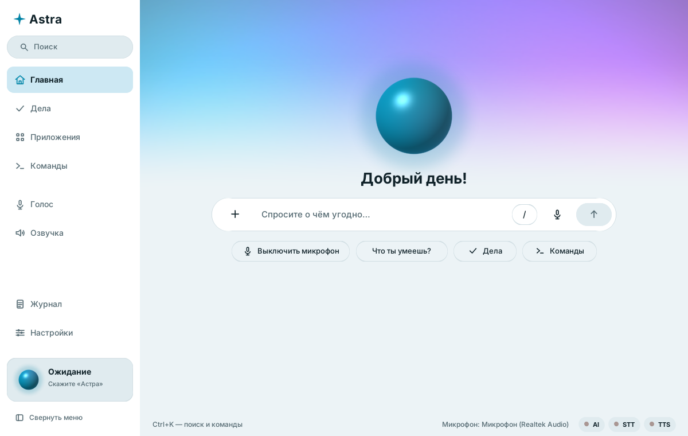<br><sub>Светлая тема со своей картинкой на фоне</sub></td>
    <td width="50%">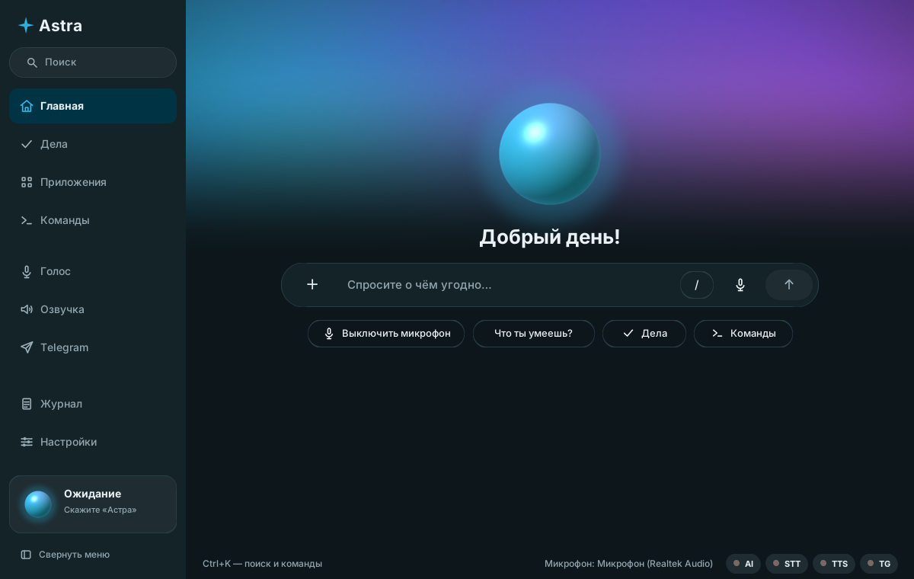<br><sub>Та же картинка в тёмной теме</sub></td>
  </tr>
</table>

Шар на главной и внизу меню живёт: он по-разному «дышит», пока ассистент ждёт, слушает, думает и говорит, а при паузе микрофона затихает.

**Горячие клавиши** (работают и с русской раскладкой):

| Клавиши | Действие |
|---|---|
| `Ctrl+K` | Быстрый поиск: страницы, действия, настройки оформления и команды ассистента; последняя строка отправляет набранное ассистенту как вопрос |
| `Ctrl+N` | Новый диалог |
| `Ctrl+M` | Включить или выключить микрофон |
| `Ctrl+,` | Настройки |
| `Ctrl+1` … `Ctrl+8` | Страницы по порядку в меню |

Если выбранное оформление почему-то не удалось построить, программа сама возвращается к исходному и пишет причину в журнал. Кнопка «Сбросить оформление» в настройках делает то же вручную.

---

## ⏰ Дела и приложения

Всё это работает голосом (после слова «Астра») и текстом (поле ввода на главной странице или вкладка «Дела»).

| Что сказать | Что произойдёт |
|---|---|
| «Поставь таймер на десять минут», «таймер на полчаса», «таймер на час тридцать чай» | Таймер; по окончании — звук, голос и окно в углу экрана |
| «Разбуди меня в семь тридцать», «будильник на 7:30 по будням», «будильник каждый день в шесть утра» | Будильник (можно с повтором) |
| «Напомни через час позвонить маме», «напомни завтра в девять утра про встречу», «напомни в восемь вечера купить хлеб» | Напоминание |
| «Какие таймеры», «сколько осталось на таймере», «отмени все таймеры» (так же для будильников и напоминаний) | Список и отмена |
| «Добавь задачу купить молоко», «что в списке задач», «выполни задачу два», «удали задачу один», «очисти выполненные задачи» | Список задач |
| «Открой калькулятор», «запусти блокнот», «открой телеграм» | Запуск программы |

<p align="center">
  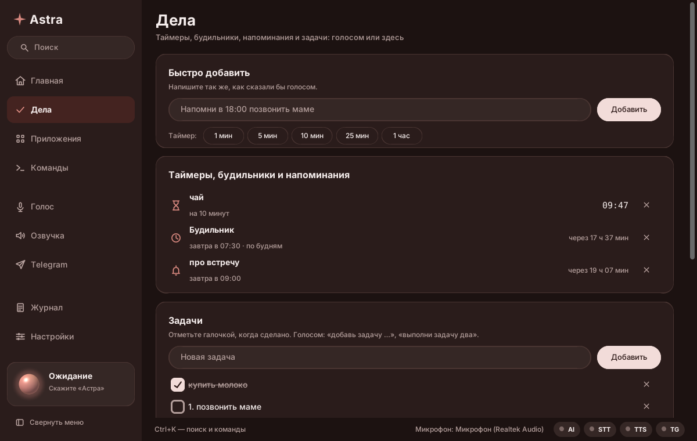
</p>

В окне уведомления можно нажать «Готово» или «Ещё 5 мин». Таймеры и напоминания сохраняются в папке `data/` и переживают перезапуск; напоминание, которое пропустили, пока программа была закрыта, сработает при запуске.

Программы берутся из встроенного списка (Блокнот, Калькулятор, Проводник, Paint, Word, Excel и др.), из ярлыков меню «Пуск» (по-английски названные программы понимаются и по-русски: «телеграм», «дискорд») и из вкладки «Приложения» → «Добавить программу».

---

## 🔊 Голоса ассистента

Вкладка «Озвучка»: выбор голоса, темп и громкость, кнопка «Слушать» у каждого голоса.

<p align="center">
  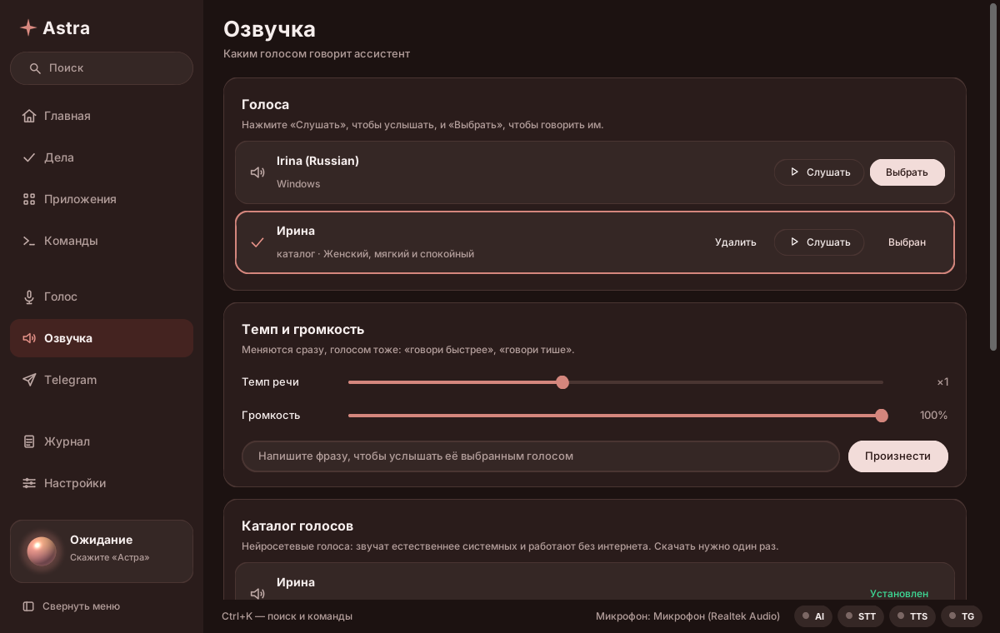
</p>

- **Голоса Windows** (Ирина, Павел и другие, что установлены в системе) работают сразу.
- **Каталог нейроголосов** (Ирина, Денис, Дмитрий, Руслан): звучат естественнее, работают без интернета после одной загрузки (≈67 МБ каждый). Движок — [sherpa-onnx](https://github.com/k2-fsa/sherpa-onnx), модели Piper.
- **Свой голос:** «Добавить свой голос» → выберите файл Piper (`.onnx`; рядом должен лежать `.onnx.json`), готовый архив или папку sherpa-onnx. Русские голоса Piper лежат на [huggingface.co/rhasspy/piper-voices](https://huggingface.co/rhasspy/piper-voices/tree/main/ru/ru_RU). Файлы копируются в `data/voices/`, голос можно удалить кнопкой.
- **Голосом:** «смени голос», «говори голосом Денис», «каким голосом ты говоришь», «говори быстрее / медленнее / тише / громче».
- Если нейроголос по какой-то причине не сработал, фразу произнесёт голос Windows, ассистент не замолчит.

---

## 🎤 Распознавание речи

### Маленькая и большая модель

Вместе с проектом идёт маленькая модель Vosk (`vosk-model-small-ru-0.22`, ~45 МБ). Она запускается мгновенно и
слушает слово «Астра». Команды можно распознавать точнее с большой моделью: по таблице авторов Vosk она
ошибается в 2–4 раза реже, но весит больше гигабайта, дольше загружается и занимает много оперативной памяти.

```
uv run python scripts/download_vosk_model.py
```

Скрипт скачивает `vosk-model-ru-0.42` в `src/assets` (докачивает при обрыве, проверяет место на диске).
Настройки не нужны: после перезапуска ассистент находит модель сам, загружает её в фоне и сообщает об этом
в чате. Пока она грузится, команды распознаёт маленькая. Если большой модели нет или она не загрузилась,
всё продолжает работать на маленькой. В git большая модель не попадает.

Время работы распознавания в миллисекундах видно в чате под каждой вашей фразой, так что разницу можно
сравнить на своём компьютере.

### Проверка микрофона

Вкладка «Голос» → «Проверка микрофона»: ассистент 5 секунд слушает выбранное устройство, показывает уровень
сигнала, говорит, в чём проблема (нет сигнала, слишком тихо, слишком громко) и показывает, что он расслышал.

### Голос владельца

Там же, «Голос владельца»: скажите «Астра» пять раз, и ассистент запомнит, как звучит ваш голос. После этого он
реагирует на слово активации только в вашем исполнении, а профиль сам подстраивается под вас по ходу работы.
Чувствительность настраивается ползунком, профиль можно сбросить. Он хранится только на вашем компьютере
(`src/config/voice_profile.json`) и в git не попадает.

---

## 🧠 Настройка ИИ-ответов

Ассистент использует локальную LLM-модель с кастомизированным system_prompt<br>
**Правила:**
- **Краткие, но информативные** (1-2 предложения)
- **Дружелюбные и естественные**
- **Предложение поиска в интернете, если нужны точные данные (курс валют и т.д.)**
- **Блокировку вредоносных, опасных или неэтичных запросов**
- **Без сложных терминов**
- **Структурированные** для списков/инструкций

## 💬 Примеры команд
```bash
"Астра, открой браузер"
"Астра, какая погода?" → ассистент: "Укажите город" → пользователь называет город → ассистент сообщает погоду"
"Астра, выключи компьютер"
"Астра, поставь таймер на десять минут"
"Астра, добавь задачу купить молоко"
"Астра, говори тише"
```
Список всех команд — на вкладке «Команды», каждую можно запустить кнопкой.

---

## 📋 Требования
- Windows 10/11
- Python 3.13 (отдельно ставить не нужно: его поставит `uv`, см. `.python-version`)
- Микрофон
- Интернет *(при первом запуске для установки пакетов и по желанию для больших моделей и голосов; в работе — только для некоторых функций: погода, новости, поиск и онлайн-медиа)*
- Google Chrome *(для онлайн-медиа)*

## 📦 Установка вручную
1. Клонируйте репозиторий:
   ```bash
   git clone https://github.com/Inlerno/Voice_Assistant.git
   cd Voice_Assistant
   ```
2. Установите [uv](https://docs.astral.sh/uv/), если его ещё нет (`Astra.bat` делает это сам).
3. Установите зависимости (`uv` сам создаст окружение `.venv` и поставит нужный Python):
   ```bash
   uv sync
   ```
4. Запустите ассистента:
   ```bash
   uv run python run.py
   ```

## 🧪 Тесты
```bash
uv run python -m unittest discover -s tests
```
Тесты покрывают ядро ассистента, проверку микрофона, голос владельца, большую модель, дела (таймеры, задачи, запуск
программ), голоса, палитру и настройки оформления, шар-индикатор, быстрый поиск, обои и окно целиком. Тест окна
открывает его на мгновение. На сервере без экрана (Linux) его запускают через
`xvfb-run -a python -m unittest discover -s tests`, а без экрана он просто пропускается.

## 📁 Структура проекта
```text
Voice_Assistant/
├── run.py                            # Запуск: uv run python run.py
├── Astra.bat                         # Запуск в один щелчок на Windows
├── CHANGELOG.md                      # История изменений
├── pyproject.toml, uv.lock           # Зависимости
├── .python-version                   # Версия Python
├── docs/screenshots/                 # Снимки интерфейса для README
├── scripts/
│   └── download_vosk_model.py        # Скачивание большой модели распознавания речи
├── src/
│   ├── main.py                       # Точка входа
│   ├── core/
│   │   └── assistant_core.py         # Ядро: прослушивание, команды, ответы
│   ├── speech/                       # Работа с речью
│   │   ├── speech_module.py          # Распознавание речи (Vosk)
│   │   ├── voice_profile.py          # Голос владельца
│   │   ├── voice_commands.py         # Голосовое управление озвучкой («говори тише»)
│   │   ├── tts_module.py             # Озвучка: голоса Windows и нейроголоса
│   │   └── voices.py                 # Голоса: каталог, свои голоса, настройки
│   ├── audio/
│   │   ├── sound_module.py           # Воспроизведение звуков
│   │   └── mic_test.py               # Проверка микрофона
│   ├── system/
│   │   └── system_control.py         # Управление ОС
│   ├── productivity/                 # Таймеры, будильники, напоминания, задачи, запуск программ
│   │   ├── planner.py, ru_parse.py   # Дела и разбор русских дат и времени
│   │   └── apps.py, skills.py        # Запуск программ и голосовые фразы дел
│   ├── interface/                    # Пользовательский интерфейс (customtkinter)
│   │   ├── interface.py              # Окно: меню, страницы, строка состояния, перестройка по настройкам
│   │   ├── nav.py                    # Боковое и верхнее меню, строка состояния
│   │   ├── home_page.py              # Главная: шар или логотип, приветствие, поле ввода, диалог
│   │   ├── settings_page.py          # Настройки: оформление, главная, модели
│   │   ├── preferences.py            # Настройки оформления (data/ui.json): проверка и сохранение
│   │   ├── palette.py                # Цвета из одного акцента (OKLCH), проверка контраста
│   │   ├── orb.py                    # Живой шар-индикатор состояния
│   │   ├── wallpaper.py              # Своя картинка на главной: размер, размытие, затемнение
│   │   ├── command_palette.py        # Быстрый поиск (Ctrl+K)
│   │   ├── voice_page.py             # Микрофон, проверка микрофона, голос владельца
│   │   ├── planner_page.py           # Дела: таймеры, будильники, напоминания, задачи
│   │   ├── apps_page.py              # Приложения, которые можно открыть голосом
│   │   ├── tts_page.py               # Озвучка: голоса, каталог, свои голоса
│   │   ├── notification.py           # Окно «сработал таймер / будильник»
│   │   ├── pages.py                  # Команды, модель, журнал
│   │   ├── widgets.py, theme.py      # Кнопки, переключатели, подсказки, карточки; цвета и шрифт из настроек
│   │   ├── ctk_fixes.py              # Обход ошибки customtkinter при смене масштаба
│   │   └── graphics.py               # Иконки и фоновое свечение (Pillow)
│   ├── integrations/
│   │   └── chat_gpt.py               # Языковая модель
│   ├── network/
│   │   └── network.py                # Сетевые операции
│   ├── services/                     # Сервисы контента
│   │   ├── film_service.py
│   │   ├── music_service.py
│   │   └── web_driver_manager.py
│   ├── config/
│   │   ├── commands.json             # Команды ассистента
│   │   └── settings.json             # Выбранный микрофон и тема (тёмная, светлая, системная)
│   └── assets/
│       ├── img/                      # Баннер и значки
│       ├── sounds/                   # Звуки запуска и выключения
│       ├── main_applications/        # Ярлыки программ
│       └── vosk-model-small-ru-0.22/ # Маленькая модель распознавания речи
├── tests/                            # Тесты (unittest)
├── data/                             # Появляется при работе, в git не попадает: дела, оформление, голоса
└── logs/                             # Появляется при работе, в git не попадает: assistant.log
```

## 🧩 Архитектура системы
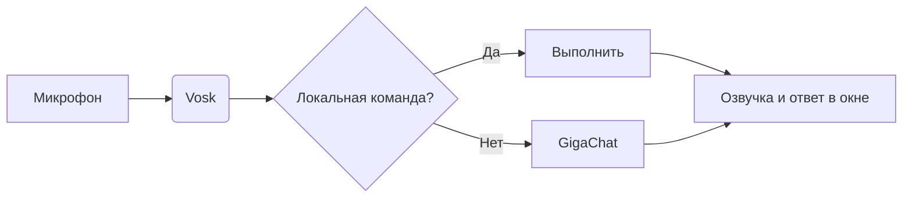

## 🔌 Технологии
| Модуль          | Описание                          |
|-----------------|-----------------------------------|
| `vosk`          | Оффлайн распознавание речи        |
| `sounddevice`   |Запись аудио с микрофона           |
| `pyttsx3`       | Синтез речи (голоса Windows)      |
| `sherpa-onnx`   | Нейроголоса (Piper), свои голоса  |
| `numpy`         | Работа с аудиоданными, шар-индикатор |
| `RapidFuzz`     | Нечеткий поиск команд             |
| `lmstudio`      | Локальные LLM-модели для ответов  |
| `selenium`      | Автоматизация браузера для медиа  |
| `fake-useragent`| Генерация случайных User-Agent для веб-запросов|
| `webdriver-manager`| Управление драйверами для Selenium|
| `feedparser`   | Чтение новостей RSS-лент|
| `BeautifulSoup`| Очистка текста новостей от HTML-тегов|
| `requests`         |HTTP-запросы к API и веб-серверам|
| `pygame`        | Воспроизведение аудио             |
| `pywin32`       | Интеграция с Windows API          |
| `keyboard`      | Эмуляция нажатия клавиш           |
| `pyperclip`     | Работа с буфером обмена           |
| `customtkinter` | Современный GUI интерфейс         |
| `pillow`        | Иконки, шар-индикатор и фон интерфейса |

## 📜 История изменений

Что и когда менялось — в файле [CHANGELOG.md](CHANGELOG.md).
